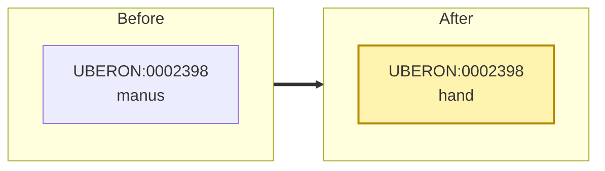
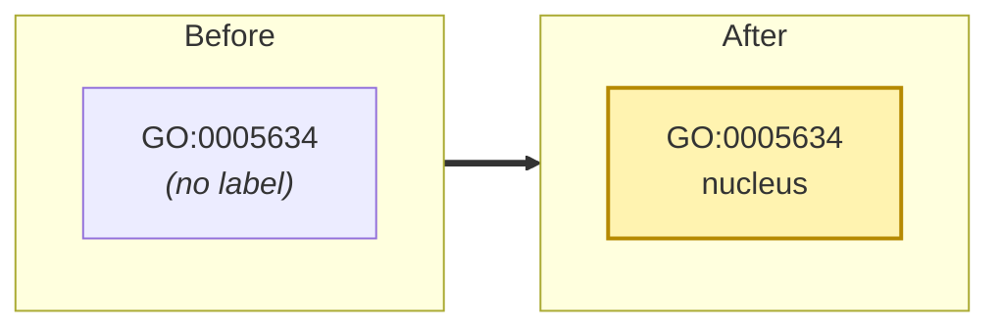
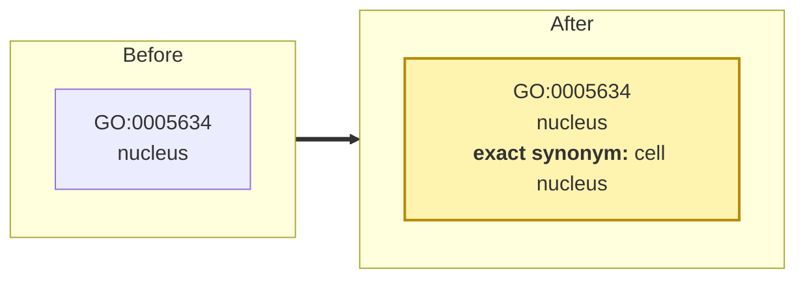
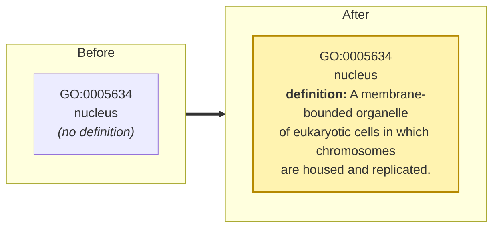
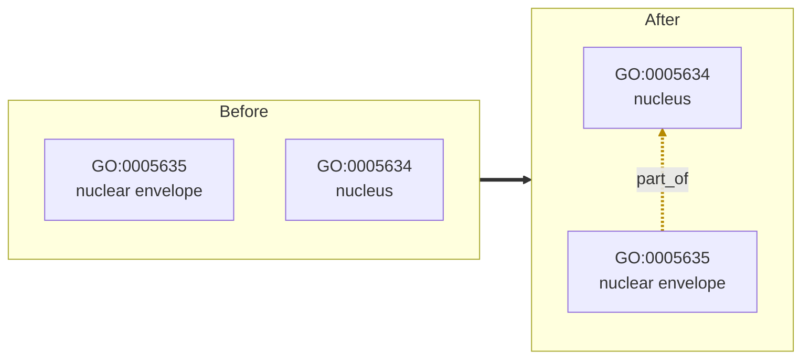
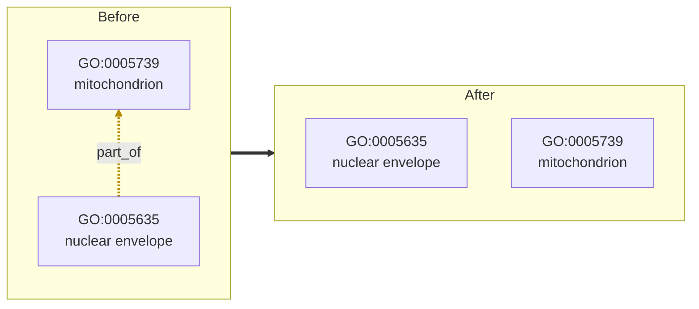
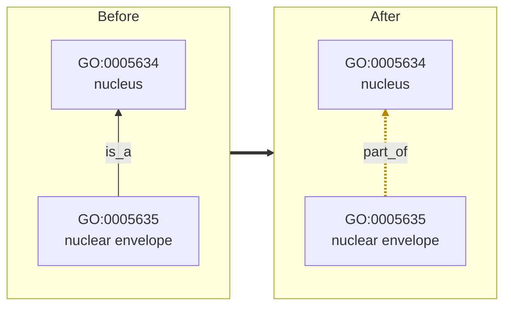
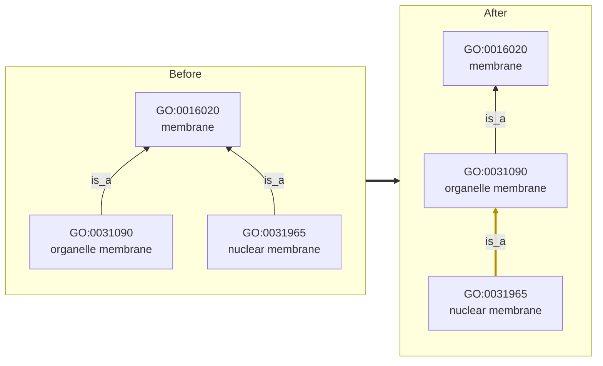
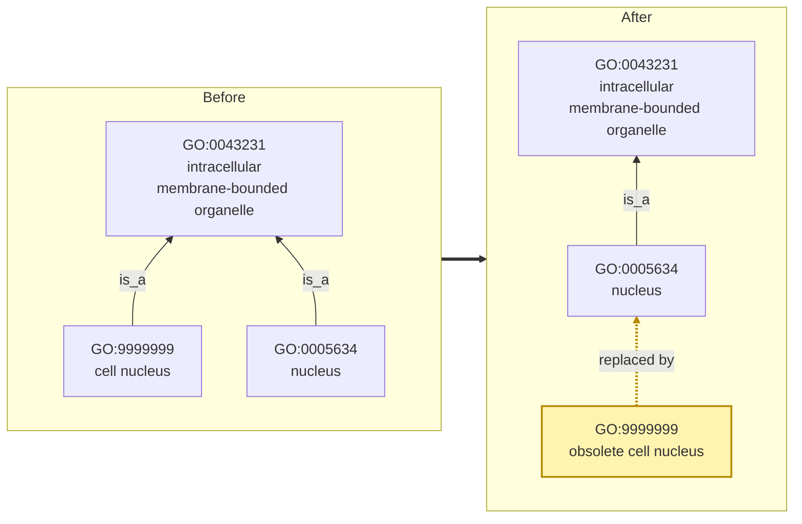
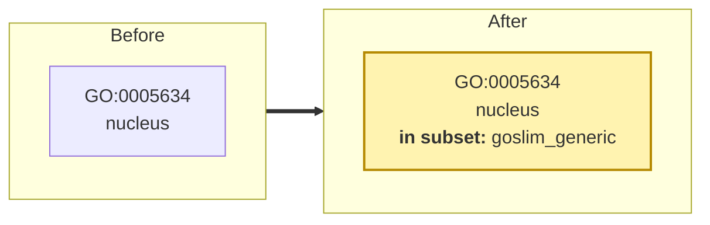

# Visual guide to change types

Each section below shows a small piece of an ontology **before** and **after** a
KGCL change, followed by the KGCL command that makes the change. Changed elements are
highlighted. Arrows point from a term to its parent: solid arrows are `is_a`
(`rdfs:subClassOf`) and dashed arrows are other relationships, such as `part_of`
(`BFO:0000050`).

The examples use real terms from the [Gene Ontology](https://geneontology.org) and
[Uberon](https://obophenotype.github.io/uberon/), but the edits are illustrations,
not changes anyone has requested. For the full list of command forms and their YAML
serializations, see [Command examples](examples.md). For every change type in the
model, see the [class hierarchy](class-hierarchy.md) or the
[schema reference](schema-reference.md).

## Labels

### Rename a term: `NodeRename`

Replaces a term's existing label (`rdfs:label`).



```kgcl
rename UBERON:0002398 from 'manus' to 'hand'
```

### Label an unlabeled term: `NewLabel`

Adds a label to a term that has none. Use `rename` when the term already has a label.
A language tag is optional.



```kgcl
add label 'nucleus' to GO:0005634
add label 'noyau'@fr to GO:0005634
```

## Synonyms

### Add a synonym: `NewSynonym`

The synonym scope (`exact`, `narrow`, `broad`, or `related`) is optional.



```kgcl
create exact synonym 'cell nucleus' for GO:0005634
```

The related commands:

```kgcl
remove synonym 'cell nucleus' for GO:0005634
change synonym 'cell nucleus' for GO:0005634 to 'cell nucleus proper'
```

## Definitions

### Add a definition: `NewTextDefinition`



```kgcl
add definition 'A membrane-bounded organelle of eukaryotic cells in which chromosomes are housed and replicated.' to GO:0005634
```

The related commands:

```kgcl
change definition of GO:0005634 to 'A membrane-bounded organelle that contains the chromosomes.'
remove definition for GO:0005634
```

## Relationships (edges)

### Add a relationship: `EdgeCreation`



```kgcl
create edge GO:0005635 BFO:0000050 GO:0005634
```

When the predicate is `rdfs:subClassOf`, the change is a `PlaceUnder`, a kind of
`EdgeCreation`.

### Remove a relationship: `EdgeDeletion`



```kgcl
delete edge GO:0005635 BFO:0000050 GO:0005739
```

When the predicate is `rdfs:subClassOf`, the change is a `RemoveUnder`.

### Change a relationship's type: `PredicateChange`

Keeps the two terms connected, but changes how. Here an `is_a` becomes `part_of`.



```kgcl
change relationship between GO:0005635 and GO:0005634 from rdfs:subClassOf to BFO:0000050
```

### Move a term to a more specific parent: `NodeDeepening`

Replaces a parent with one of that parent's own descendants. `shallow` does the
reverse, moving a term to a more general parent.



```kgcl
deepen GO:0031965 from GO:0016020 to GO:0031090
shallow GO:0031965 from GO:0031090 to GO:0016020
```

## Obsoletion

### Obsolete a term and name its replacement: `NodeObsoletionWithDirectReplacement`

Obsoletion marks a term as no longer to be used, without deleting it, so existing
annotations that use the term can still be interpreted. Naming a replacement lets
those annotations be updated automatically. Here, `GO:9999999` stands for an
accidental duplicate of *nucleus*.



```kgcl
obsolete GO:9999999 with replacement GO:0005634
```

Without a replacement: `obsolete GO:9999999`. To reverse an obsoletion:
`unobsolete GO:9999999`.

!!! note
    Exactly how an obsoletion is carried out (for example, prefixing the label with
    "obsolete", removing the term's parent relationships, or adding a
    `term replaced by` annotation) depends on the ontology's obsoletion policy and
    on the tool applying the change. The diagram shows a common OBO-style result.

## Subsets

### Add a term to a subset: `AddNodeToSubset`

Subsets (also called *slims*) are curated selections of terms, such as the generic
GO slim.



```kgcl
add GO:0005634 to subset goslim_generic
remove GO:0005634 from subset goslim_generic
```

## Creating and deleting terms

These change the set of terms rather than a term's content, so they have no diagram.

| Change type | Command |
| --- | --- |
| `ClassCreation` | `create GO:9999999` |
| `NodeCreation` (with a label) | `create node GO:9999999 'cell nucleus'` |
| `NodeDeletion` | `delete GO:9999999` |

Deleting a term removes it entirely. In most published ontologies, obsoletion is
preferred, because other resources may already refer to the term.
