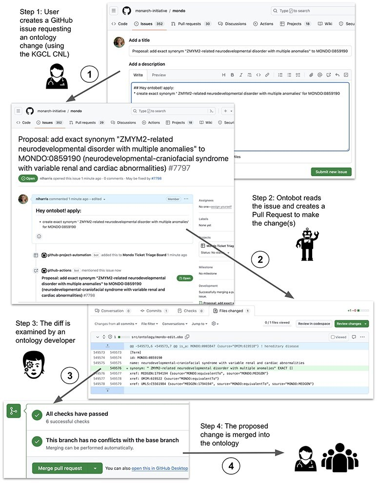
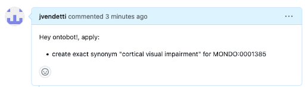
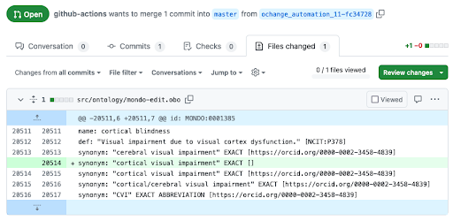

# Ontobot: applying KGCL from GitHub issues

Many ontologies are developed on GitHub: change requests arrive as issues, and changes
are made through pull requests (PRs). Turning each request into an edit by hand is
slow, and it depends on an ontology editor having time to do it.
[Ontobot](https://github.com/INCATools/ontobot-change-agent) (the
`ontobot-change-agent`) automates the middle of that process. It reads KGCL commands
from an issue and opens a PR that makes the change. A curator still reviews and
approves every PR.

Ontobot runs as a GitHub Action, so an ontology repository can add it without any
other infrastructure. Repositories that use it include GO, Mondo, Uberon, ENVO, the
Cell Ontology, and PATO; see the
[Ontobot README](https://github.com/INCATools/ontobot-change-agent#readme) for the
current list.

## How it works

Ontobot watches new and edited issues for the phrase **`Hey ontobot!, apply:`** (the
`!` is optional), followed by a bulleted list of KGCL commands:

```markdown
Hey ontobot!, apply:

- create exact synonym 'cortical visual impairment' for MONDO:0001385
- create related synonym 'CVI' for MONDO:0001385
```

<figure markdown>
  { width="560" }
  <figcaption>
    <b>A change request handled by Ontobot.</b> (1) A user opens an issue in the
    ontology repository containing <code>Hey ontobot!, apply:</code> and a KGCL
    command, here adding an exact synonym to a Mondo term. (2) Ontobot sees the
    instruction and responds. (3) Ontobot opens a PR that makes the change in the
    ontology source file, and curators are assigned to review it. (4) Once a curator
    approves, the PR is merged and the change appears in the next release.
    Reproduced from <a href="https://doi.org/10.1093/database/baae133">Hegde <i>et al.</i> 2025</a>, Fig. 4
    (<a href="https://creativecommons.org/licenses/by/4.0/">CC BY 4.0</a>).
  </figcaption>
</figure>

## Close-up: the issue and the pull request

An issue asking Ontobot to add a synonym to a Mondo term:



The change in the PR that Ontobot opens in response:



If a maintainer is satisfied with the change, they approve the PR and it is merged into
the ontology source file. Otherwise they can edit it or close it, like any other PR.

## Setting it up

The [Ontobot manual](https://incatools.github.io/ontobot-change-agent/) covers
installation and provides a workflow template (`.github/workflows/ontobot.yaml`) to
customize and add to the repository that holds the ontology source file.

Curators who would rather not write KGCL at all can request changes through
[BioPortal](bioportal-implementation.md), which writes the KGCL and opens the issue
for them.
