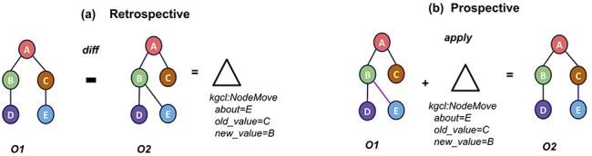
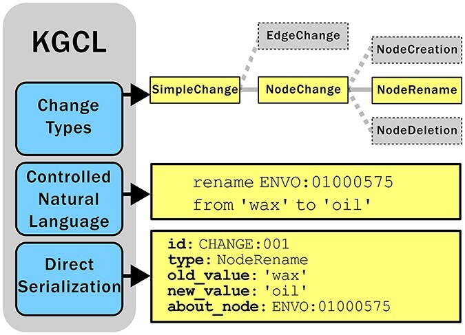

# KGCL: Knowledge Graph Change Language

The Knowledge Graph Change Language (KGCL) is a standard for describing changes to
ontologies and knowledge graphs (KGs). It describes changes at a high level, the way
curators and ontology editors think about them: *rename this term*, *add a synonym*,
*move this class under a different parent*, *obsolete this term and point to its
replacement*.

```kgcl
rename UBERON:0002398 from 'manus' to 'hand'
create exact synonym 'cell nucleus' for GO:0005634
obsolete GO:9999999 with replacement GO:0005634
```

!!! info "Source"
    Portions of this page, and Figures 2 and 3, are adapted from
    [Hegde *et al.*, *A change language for ontologies and knowledge graphs*,
    Database (2025)](https://doi.org/10.1093/database/baae133), used under the
    [CC BY 4.0](https://creativecommons.org/licenses/by/4.0/) license.
    See [Citing KGCL](about.md).

## Why a change language?

Ontologies and KGs are never finished. Terms are added, merged, and obsoleted; labels,
definitions, and synonyms are corrected; and relationships are refined as knowledge
improves. The Gene Ontology, for example, is more than 20 years old, and it still
changes in every release.

Despite this, there has been no single agreed-upon way to *represent* or *communicate*
those changes. That gap shows up in two places:

- **Retrospective changes ("diffs").** How do you tell people what changed between two
  releases? Comparing ontology *O1* with *O2* should produce the most parsimonious set
  of changes that turns one into the other. In the figure below, that is a single move
  of node E from under C to under B.
- **Prospective changes ("patches").** How do you ask for a change you want? *Applying*
  a change to *O1* produces *O2*. Today, change requests usually arrive as free-text
  GitHub issues, which an ontology editor then has to translate by hand into edits in
  a tool such as Protégé.

<figure markdown>
  
  <figcaption>
    <b>The logic of ontology changes.</b> (a) A <i>diff</i> between O1 and O2 yields a
    change object, here a <code>NodeMove</code>. (b) <i>Applying</i> that change object
    to O1 yields O2.
    Reproduced from <a href="https://doi.org/10.1093/database/baae133">Hegde <i>et al.</i> 2025</a>, Fig. 2
    (<a href="https://creativecommons.org/licenses/by/4.0/">CC BY 4.0</a>).
  </figcaption>
</figure>

A low-level diff of OWL axioms is precise, but it doesn't match how editors think about
changes: the move above would show up as one deleted axiom and one added axiom. In a
2023 community survey, 82% of ontology users said staying informed about changes was
very or extremely important, yet only 8% were satisfied with the existing ways of
viewing them. KGCL provides the higher-level representation that was missing.

## The three parts of KGCL

<figure markdown>
  { width="560" }
  <figcaption>
    <b>The components of KGCL.</b> (a) A classification of change types, (b) a
    controlled natural language (CNL) for writing changes, and (c) a data model that
    serializes directly to formats such as YAML.
    Reproduced from <a href="https://doi.org/10.1093/database/baae133">Hegde <i>et al.</i> 2025</a>, Fig. 3
    (<a href="https://creativecommons.org/licenses/by/4.0/">CC BY 4.0</a>).
  </figcaption>
</figure>

1. **A classification of change types.** Changes that affect terms (nodes) and changes
   that affect relationships (edges) form two branches of one hierarchy. For example,
   `NodeRename` is a kind of `NodeChange`, alongside `NodeCreation` and `NodeDeletion`.
   Browse it in the [class hierarchy](class-hierarchy.md), or see each type drawn out
   in the [visual guide](change-types.md).
2. **A controlled natural language (CNL).** A restricted subset of English that people
   can read and write, and that machines can parse without ambiguity:
   `rename ENVO:01000575 from 'wax' to 'oil'`. The CNL is defined by a
   [Lark grammar](https://github.com/INCATools/kgcl/blob/main/src/kgcl_schema/grammar/kgcl.lark).
3. **A data model.** Each change type has a defined set of attributes. Every change has
   an `id`; a `NodeRename` also has `about_node`, `old_value`, and `new_value`. The model
   is written in [LinkML](https://linkml.io), so the same change can be written as the
   CNL, JSON, YAML, or RDF, or as a table in a spreadsheet (less expressive).

The same rename in two of those forms:

=== "CNL"

    ```kgcl
    rename ENVO:01000575 from 'wax' to 'oil'
    ```

=== "YAML"

    ```yaml
    id: CHANGE:001
    type: NodeRename
    about_node: ENVO:01000575
    old_value: wax
    new_value: oil
    ```

## Tools that use KGCL

| Tool | What it does with KGCL |
| --- | --- |
| [Ontobot](github-integration.md) | GitHub Action that reads KGCL commands from an issue and opens a pull request that applies them to the ontology |
| [BioPortal](bioportal-implementation.md) | Web forms that let curators propose changes without writing KGCL; BioPortal writes the KGCL and files the issue for Ontobot |
| [Ontology Access Kit (OAK)](https://github.com/INCATools/ontology-access-kit) | Python library and command line: `diff` two ontologies into KGCL, or `apply` KGCL to an ontology |
| [KGCL-Java](https://github.com/gouttegd/kgcl-java) and its ROBOT plugin | Java parser and serializer, and a `robot apply` command for use in ROBOT pipelines |
| This repository (`kgcl-schema` on PyPI) | The schema, the generated Python data model, and the CNL parser and renderer |

Not every tool supports every change type yet.

## Using the parser

```bash
pip install kgcl-schema
kgcl-parse "create exact synonym 'cell nucleus' for GO:0005634"
```

From Python:

```python
from kgcl_schema.grammar.parser import parse_statement
from kgcl_schema.grammar.render_operations import render

change = parse_statement("add label 'nucleus' to GO:0005634")
type(change).__name__   # 'NewLabel'
render(change)          # "add label 'nucleus' to GO:0005634"
```

## Persistent URIs

These URIs resolve to the KGCL standard:

- JSON-LD context: <https://w3id.org/kgcl/kgcl.context.jsonld>
- OWL: <https://w3id.org/kgcl/kgcl.owl.ttl>
- SHACL: <https://w3id.org/kgcl/kgcl.shacl.ttl>
- YAML (LinkML schema): <https://w3id.org/kgcl/kgcl.yaml>

The KGCL classification is also
[browsable on BioPortal](https://bioportal.bioontology.org/ontologies/KGCL).
